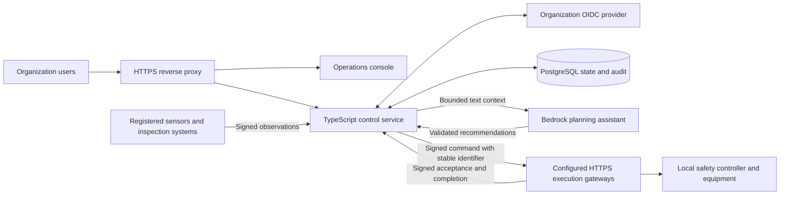
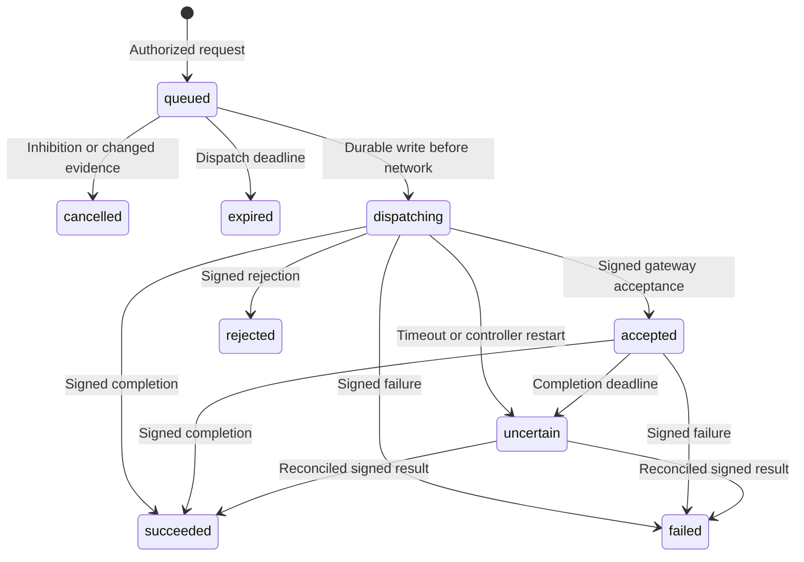

# Architecture

In production, the TypeScript control service is the authority for operations. The production browser console renders authenticated service data and submits requests; it has no operational state generator. A missing service or expired session disables mutations. Empty registries and devices awaiting observations are shown explicitly.

The separate [simulation build](SIMULATION.md) runs a browser-local instance of the same controller with generated devices and an in-memory gateway. Only that build enables the simulator. The hosted Site serves this simulation; production deployment remains the Node.js/PostgreSQL service described here.

## Identity and request control

OIDC authorization code flow uses PKCE, state and nonce verification. Access tokens require RS256 or ES256 signatures, issuer, a dedicated resource audience, expiry, issue time, subject, facility claim and platform roles. The web client audience must differ from the API audience. Browser sessions are encrypted, short lived, HttpOnly, Secure cookies. Session mutations require the configured origin and CSRF token. Header names supplied by a caller do not select an identity.

`viewer` can read operational data. `operator` can request transfers and inhibit new dispatch. `supervisor` and `admin` may release dispatch and review responses. Quarantine needs two distinct issuer-qualified subjects. Credentials and device secrets are excluded from API responses and logs.

## Measurements and model provenance

Device messages are strict typed envelopes signed over their exact UTF-8 bytes. Each device has its own key, kind, capabilities, required status and optional execution endpoint. The service validates timestamp freshness, a durable increasing sequence and message identity before committing. Inspection results additionally identify an approved model version and artifact SHA-256. A signature authenticates the source's claim; it does not prove the physical scene or remotely attest the model process.

The service contains deterministic policy checks for processing-line vibration and temperature, zone temperature and inspection exceptions. Your edge inspection system supplies measured counts, confidence, inspection identity and model lineage. Model qualification and physical sensor calibration remain integration responsibilities.

The optional [Bedrock assistant](BEDROCK.md) performs text planning using `openai.gpt-oss-120b-1:0`. Only authenticated operators can request inference. The service constructs a limited context without device secrets, validates the response schema and registered identifiers, and records request and result digests in the audit ledger. Recommendations create no commands. A user must submit each action through the existing authorization and safety checks. The LLM supplies no approval votes or dispatch release.

## Decisions and execution

Dispatch starts inhibited. A supervisor releases it only when required devices have fresh observations, robots report acceptable interlocks and no unresolved delivery outcome exists. Requests are scoped to a facility and actor. Receipts deduplicate repeated operator submissions. The controller rechecks device freshness, capability, destination and evidence immediately before network transmission.

The controller never infers completion from an HTTP 2xx response without an authenticated result. It never automatically retransmits an uncertain command. Gateway deduplication must survive gateway restarts. Dispatch inhibition prevents new transmissions; it cannot revoke a request already handed to a gateway or replace a physical emergency stop.

## Persistence and availability

A transaction locks the singleton facility checkpoint, applies the change, appends hash-linked audit records and updates the checkpoint atomically. A dedicated PostgreSQL advisory-lock connection enforces one active controller per database. Losing that connection makes readiness fail. A database trigger rejects audit updates and deletes. Retained state holds bounded recent histories and command summaries; the audit ledger holds full events. Export and anchor audit heads outside this database according to organizational retention policy.

This release is a single-controller architecture. Do not increase application replicas against the same database. Recovery starts inhibited, cancels unsent old commands, clears pending approvals and marks interrupted transmissions uncertain. Take PostgreSQL backups and validate point-in-time restore. Store and rotate credentials through your deployment secret manager.

## Delivery boundary

The runtime image uses Node.js 24, a non-root user and no test doubles. Compose drops capabilities, uses a read-only application filesystem and exposes HTTPS through Caddy. Deploy to your own approved environment to connect PostgreSQL, OIDC and physical gateways. A separately hosted static console cannot provide those services.

The [AWS Terraform deployment](../../infra/terraform/README.md) uses an HTTPS ALB, private Fargate tasks and a private encrypted PostgreSQL database. The runtime task reads application and database secrets from Secrets Manager; a separate bootstrap role migrates the schema and provisions the restricted database identity. The task role can invoke only the requested regional Bedrock model. The service remains one controller per database, with deliberate interruption during replacement.
